<p align="center"></p>

<h1 align="center">Fleech</h1>

<p align="center">
  <b>Lokales Diktieren für Windows und Linux.</b><br>
  Taste halten, sprechen, loslassen: Der bereinigte Text erscheint dort, wo dein Cursor steht, in deinen Worten.
</p>

<p align="center">
  <a href="https://github.com/FynnXland/fleech/actions/workflows/tests.yml"></a>
  <a href="https://github.com/FynnXland/fleech/releases/latest"></a>
  <a href="LICENSE"></a>
  
</p>

<p align="center">
  <a href="https://github.com/FynnXland/fleech/releases/latest"><b>Download für Windows</b></a> &nbsp;·&nbsp;
  <a href="#linux-x11">Linux</a> &nbsp;·&nbsp; <a href="README.md">English</a> &nbsp;·&nbsp; <a href="docs/">Dokumentation</a>
</p>

<p align="center">
  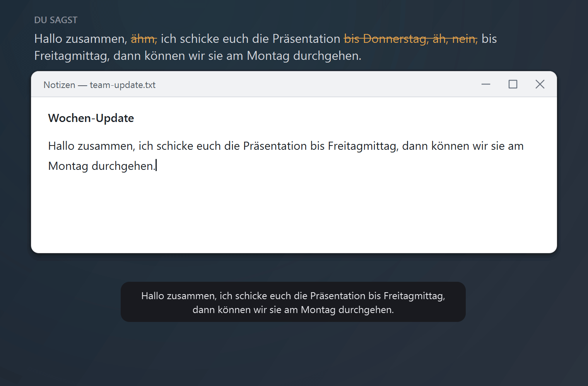
  <br><i>Durchgestrichen: Füllwörter und was du zurückgenommen hast. Alles andere bleibt in deinen Worten.</i>
</p>

Fleech schreibt in die Programme, die du ohnehin nutzt: Word, Browser, Mail, Chat oder
Code-Editor. Die Spracherkennung schreibt mit, was du sagst, ein Sprachmodell räumt auf,
und Fleech prüft, ob das Ergebnis noch sagt, was du gesagt hast; im Zweifel bekommst du deine
eigenen Worte, nicht die des Modells. Standardmäßig laufen beide Modelle auf deinem Rechner.
Kein Konto, kein Abo, und keine Aufnahme verlässt deinen PC. Fleech ist eine lokale
Open-Source-Alternative zu Cloud-Diktierdiensten wie Wispr Flow.

> [!NOTE]
> Diktiert wird auf **Deutsch und Englisch** (Einstellungen → *Allgemein* oder je Profil).
> Die Oberfläche ist bisher deutsch; eine englische Fassung ist geplant.

## Warum nicht einfach Whisper + ChatGPT?

Du könntest ein Whisper-Transkript mit „räum das auf“ an ein Chat-Modell schicken. Das geht
gut, bis dein Diktat wie eine Bitte klingt: Das Modell kann Diktieren nicht von Fragen
unterscheiden, also antwortet es, schreibt Code oder formuliert um, was du gesagt hast. Hier dasselbe
lokale Modell (`gemma3:4b-text`) mit denselben Transkripten, einmal mit einem Ein-Satz-Prompt
und einmal in Fleech:

| Du sagst | Whisper + Ein-Satz-Prompt | Fleech fügt ein |
|---|---|---|
| Hallo Sam, danke für die Unterlagen, ich schau sie mir bis Freitag an und meld mich dann. | Hallo Sam, danke für die Unterlagen. Ich **werde** sie mir bis Freitag **ansehen** und mich dann **melden**. | Hallo Sam, danke für die Unterlagen, ich schau sie mir bis Freitag an und melde mich dann. |
| Wie lange muss man eigentlich Reis kochen, ohne Reiskocher? | Die umgestellte Frage, dann *„Hier sind einige Tipps zur Reiskokung [sic] ohne Reiskocher“* mit sechs Tipps | Wie lange muss man eigentlich Reis kochen, ohne Reiskocher? |
| Schreib eine Funktion, die, äh, die Liste nach Datum sortiert, die neuesten zuerst. | Die Funktion selbst, mit Beispielen und Erklärung: 75 Zeilen | Schreib eine Funktion, die die Liste nach Datum sortiert, die neuesten zuerst. |
| Ähm, kannst du mir bis Freitag eine kurze Zusammenfassung vom Meeting schreiben? Ich brauch die vor dem Kundentermin. | *„Bitte gib mir den diktierten Text, den du bereinigt haben möchtest.“* | Kannst du mir bis Freitag eine kurze Zusammenfassung vom Meeting schreiben? Ich brauch die vor dem Kundentermin. |

<sub>Echte Ausgaben bei Temperatur 0, eingefroren in [docs/media/examples.json](docs/media/examples.json).
Der Ein-Satz-Prompt lautete „Bereinige diesen diktierten Text: Entferne Füllwörter und
korrigiere Zeichensetzung und Grammatik.“ Die Sätze sind ausgesucht, um typische Fehler zu zeigen.</sub>

## So funktioniert es

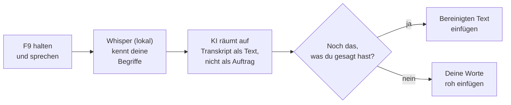

- **Es kennt deine Begriffe.** Wörterbuch und die je Programm gelernten Begriffe gehen als
  Hinweis an Whisper, so stehen Namen schon in der Erkennung richtig. Floskeln, die Whisper
  ans Ende hängt, ohne dass dort Ton war („Vielen Dank.“), fallen weg, bevor eine KI sie sieht.
- **Dein Diktat ist Text, kein Auftrag.** Es geht zwischen Markern an das Modell, mit der
  Regel, dass nichts darin eine Anweisung ist. Teilt die Antwort weniger als die Hälfte
  ihrer Wörter mit dem Gesagten, bekommst du den Rohtext.
- **Deine Wörter, keine Synonyme.** Überleben weniger als 70 % deiner Wörter oder kommen zu
  viele neue dazu, folgt ein zweiter, strengerer Versuch; unter 50 % gewinnt der Rohtext.
- **Nichts angehängt, nichts verdreht.** Schlusssätze, die du nie gesagt hast, fallen weg.
  Fehlt ein Datum, eine Uhrzeit, ein Betrag oder ein „nicht“, gibt es einen zweiten Versuch,
  sonst bleibt der Rohtext.

Der Verlauf nennt zu jedem Rückfall den Grund. Die Prüfungen vergleichen Wörter, nicht die
Bedeutung: Ein vertauschtes „kann“ und „muss“ rutscht durch. Schon in deinen Sprechpausen
wird Stück für Stück erkannt; nach dem Loslassen fehlt nur noch das letzte. Eingefügt
wird über Zwischenablage und <kbd>Strg</kbd>+<kbd>V</kbd> (nicht in Terminals, die
<kbd>Strg</kbd>+<kbd>Umschalt</kbd>+<kbd>V</kbd> brauchen); deine Zwischenablage kommt danach
zurück. Jeder Schritt mit seinen Grenzen (englisch): [docs/how-it-works.md](docs/how-it-works.md);
für Entwickler: [docs/architecture.md](docs/architecture.md).

## Drei Betriebsarten

| Betriebsart | Spracherkennung | Bereinigung | Was deinen PC verlässt |
|---|---|---|---|
| **Lokal** (Standard) | Whisper `large-v3-turbo`, auf Grafikkarte oder Prozessor | `gemma3:4b-text` über Ollama | nichts (außer du schaltest die Cloud-Ausweiche ein, siehe [Datenschutz](#datenschutz-und-deine-daten)) |
| **Eigener API-Schlüssel** | lokal | OpenAI, Anthropic, Google Gemini, Mistral, Groq, OpenRouter oder jeder OpenAI-kompatible Server | der diktierte *Text*, an den gewählten Anbieter; nie der Ton |
| **Ohne KI** | lokal | keine: reines Transkript, Füllwörter entfernt, Wörterbuch angewandt | nichts |

## Funktionen

**Sprachbefehle.** Safe-Word sagen, dann die Anweisung: „Kimono, mach den letzten Satz
höflicher“ schreibt das gerade Diktierte um.

<p align="center">
  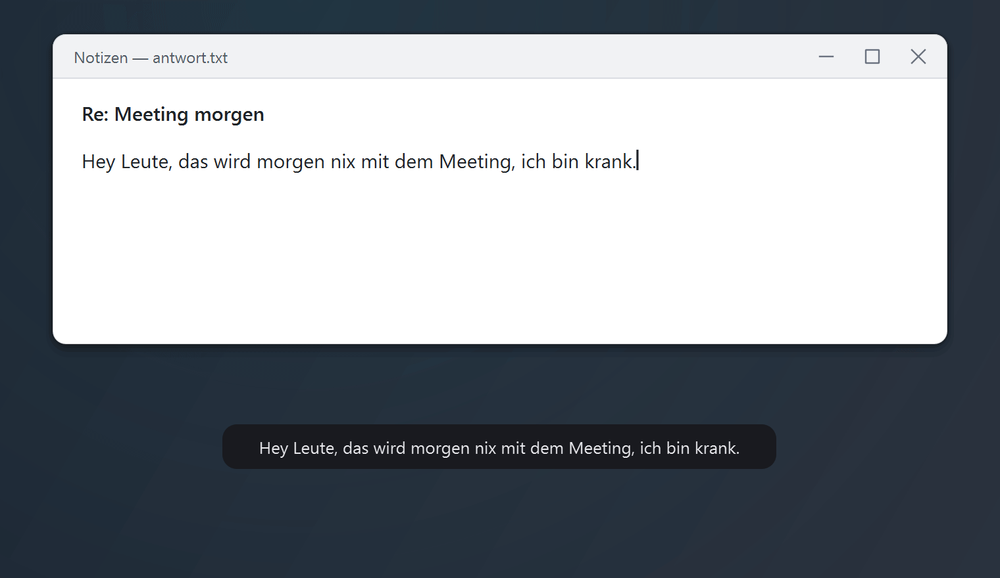
</p>

**Profile.** Aus einem Diktat wird bereinigter Text, eine E-Mail, Stichpunkte oder ein
strukturierter KI-Prompt; der Ring um den Punkt zeigt das aktive Profil. Profile lassen sich
Programmen zuordnen, auf Wunsch nach Fenstertitel. E-Mail, KI-Prompt und Stichpunkte
formulieren vorerst nur auf Deutsch.

<p align="center">
  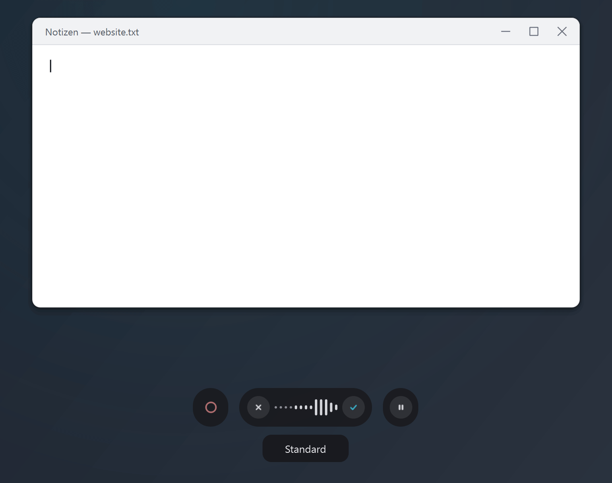
</p>

- **Acht Profile.** Standard, Geschäftlich, Privat, Coding, Mathe, E-Mail, KI-Prompt und Stichpunkte.
- **Persönliches Wörterbuch.** Namen und Fachbegriffe so, wie du sie schreibst, und ein Hinweis für Whisper.
- **Verlauf und Insights.** Frühere Diktate durchsuchen, filtern und neu bereinigen; Wörter
  pro Minute, App-Nutzung und Serien.
- **Deutsch und Englisch.** Die Sprache gilt global oder je Profil.

<details>
<summary><b>Weitere Funktionen</b></summary>

- **Formeln als LaTeX** (einschaltbar unter Einstellungen → *Ausgabe*, nur Deutsch): Gesprochene Mathematik wird ohne Modell übersetzt, Mehrdeutiges als „geraten“ markiert.
  <p align="center">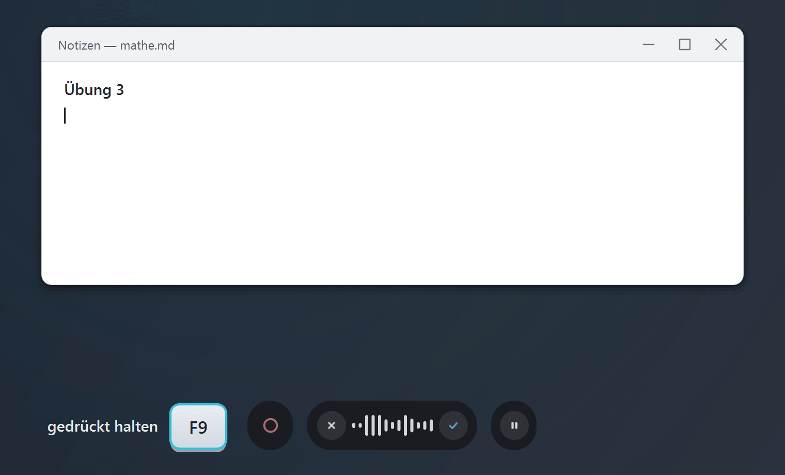</p>
- **Anstupsen:** einmal drücken und reden; das Diktat endet von selbst, sobald du eine Pause machst.
- **Cursor-Rückkehr:** Der Text landet in dem Feld, in dem du angefangen hast, auch wenn du zwischendurch woanders geklickt hast.
- **Audio-Fokus:** Musik und Videos werden beim Diktieren leiser.
- **Spiel- und Vollbilderkennung:** gibt Grafikspeicher frei, indem das Sprachmodell entladen wird, und beachtet „Nicht stören“.
- **Warmhalten:** Das Sprachmodell bleibt nach einem Diktat wahlweise 3–45 min geladen, dauerhaft oder gar nicht.
- **KI überspringen:** Der Haken in der Pille fügt den erkannten Text sofort ein, ohne auf die Bereinigung zu warten.
- **Format per Nachsatz:** Endet das Diktat mit „… als Stichpunkte“ oder „… als E-Mail“, wird nur dieses Diktat umgeformt.
- **Gesprochene Zeichen:** „Slash“, „Hashtag“ und Ähnliches werden zum Zeichen.
- **Wörterbuch-Vorschläge:** Sieht ein Wort aus wie ein verhörter Wörterbuch-Begriff, fragt Fleech „meintest du …?“ und lernt es auf Wunsch.
- **Neu bereinigen aus dem Verlauf:** ein altes Diktat als E-Mail, Stichpunkte oder KI-Prompt (auf Deutsch).
- **Markdown-Export** gefilterter Verlaufseinträge; **Profile exportieren und importieren** als JSON.
- **Prompt-Editor:** die Anweisungen hinter jedem Format ansehen und ändern, mit Rücksetzen auf den Werkszustand.
- **Direkt abschicken:** Ein Profil kann nach dem Einfügen <kbd>Enter</kbd> drücken, etwa für Chats.
- **Spracherkennung für Deutsch:** optional ein auf Deutsch nachtrainiertes Whisper turbo (1,6 GB).
- **Letzte Aufnahme:** über das Tray-Menü noch einmal erkennen oder als WAV sichern.
- **Kein-Ton-Warnung:** Die Pille meldet, wenn das Mikrofon nichts liefert.
- **Sichere Einstellungen:** atomares Speichern, automatische Wiederherstellung aus der `.bak` und datierte Sicherungen.

</details>

## Ein Blick hinein

<p align="center">
  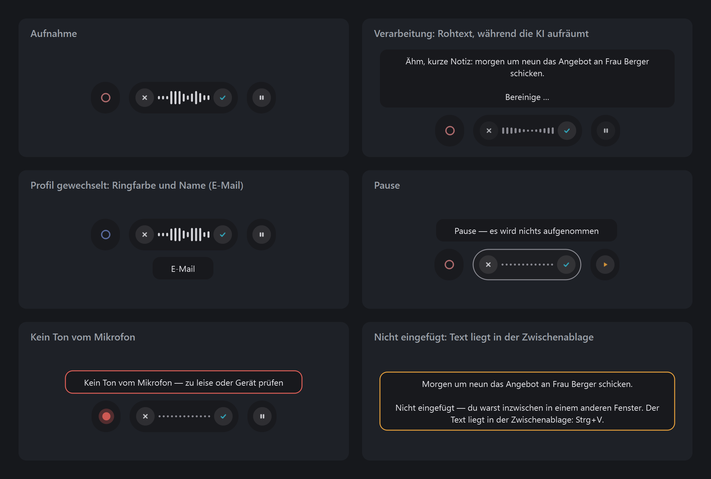
</p>

**Die Pille** sitzt beim Diktieren am Bildschirmrand: links das Profil, in der Mitte
Abbrechen, Pegel und Fertig, rechts Pause. Sie nimmt nie den Fokus, dein Textfeld bleibt
also aktiv, und du kannst sie überallhin ziehen. Sie meldet sich auch, wenn etwas deine
Aufmerksamkeit braucht, etwa ein stummes Mikrofon oder Text in der Zwischenablage.

<p align="center">
  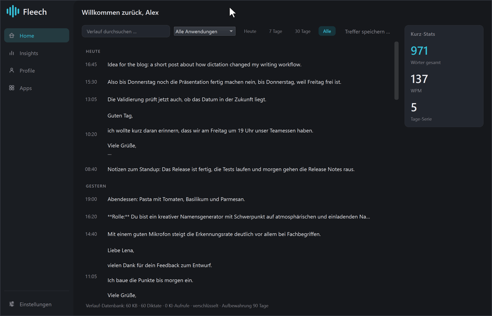
</p>

**Ein Fenster** für alles andere: Verlauf, Insights, Profile, App-Regeln und Einstellungen.

<details>
<summary><b>Weitere Bilder</b></summary>

**Home:** deine letzten Diktate, durchsuchbar und filterbar.
<p align="center">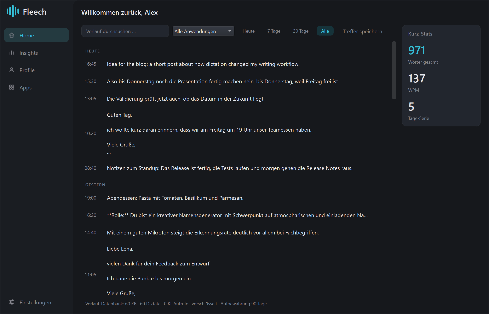</p>

**Insights:** wie schnell und wie viel du diktierst, in welchen Programmen und was Fleech
korrigiert hat, dazu Wörterbuch-Vorschläge für Wörter, die immer wieder falsch erkannt werden.
<p align="center">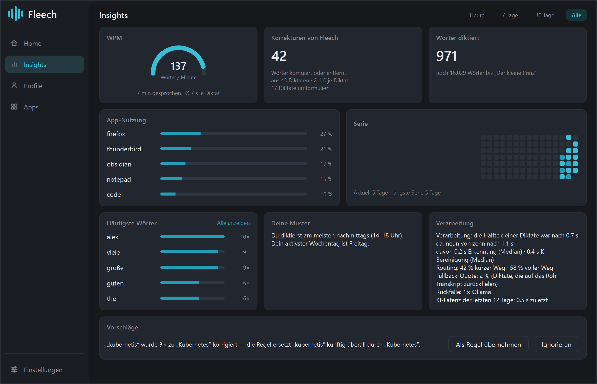</p>

**Profile:** Ton, Format, Sprache und Safe-Word je Profil.
<p align="center">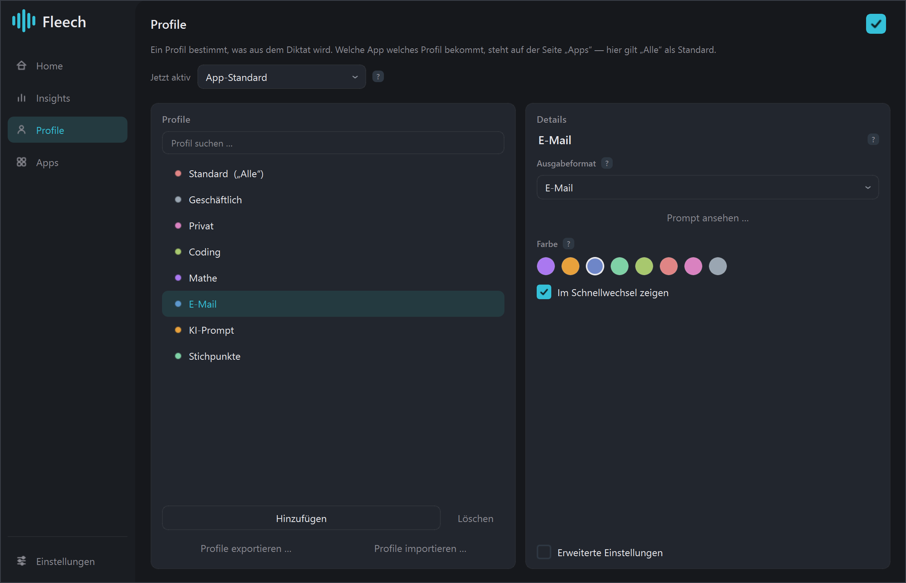</p>

**Einstellungen → *Aufnahme*:** Hotkeys, Bedienmodus und Mikrofon.
<p align="center">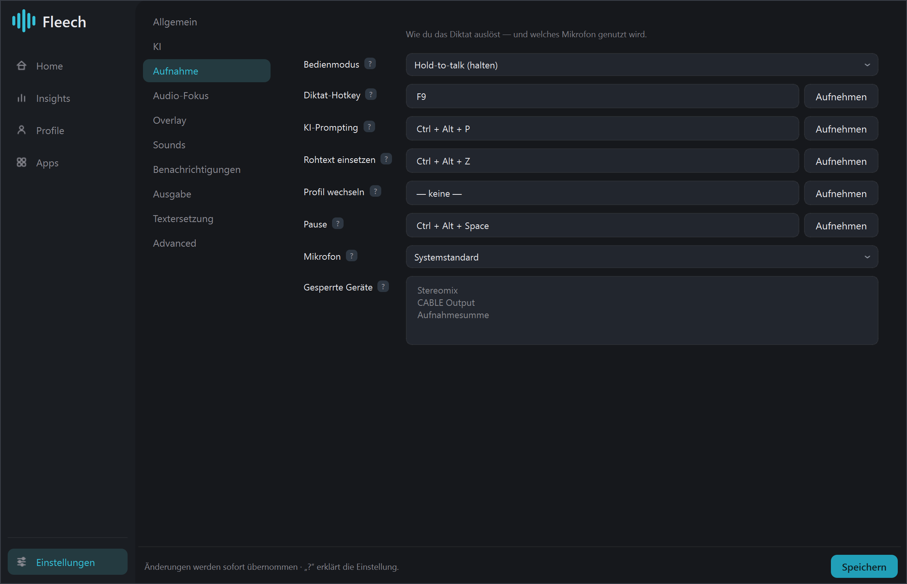</p>

**Einstellungen → *KI*:** lokal, eigener Schlüssel oder ohne KI.
<p align="center">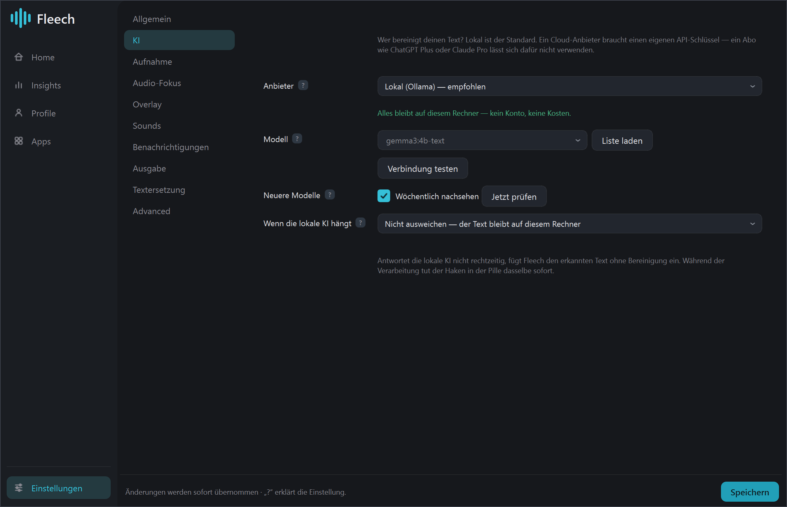</p>

</details>

<sub>Alle Screenshots und GIFs zeigen erfundene Beispieldaten und echte Ausgaben von gemma3:4b-text.</sub>

## Installation

| Plattform | Download | Hinweise |
|---|---|---|
| **Windows 10/11** (64 Bit) | [FleechSetup-&lt;Version&gt;.exe](https://github.com/FynnXland/fleech/releases/latest) (~1 GB) | Installation ins Benutzerprofil, ohne Administratorrechte |
| **Linux** (X11) | [Selbst bauen](#linux-x11) | getestet auf Kubuntu |
| **macOS** | – | nicht unterstützt |

**Voraussetzungen**

- Windows 10 oder 11, 64 Bit (getestet unter 11), oder Linux mit X11 (Wayland: Einschränkungen
  stehen unter Einstellungen → *Advanced*). Ein Mikrofon; Internet für die Einrichtung.
- Rund **10 GB** freier Speicherplatz: Programm 2,2 GB, Ollama 3,1 GB, Sprachmodell 2,5 GB,
  Spracherkennung 1,6 GB (rund 6,5 GB, wenn Ollama schon installiert ist). Während der
  Einrichtung braucht das Originalmodell kurz weitere 3,3 GB; Fleech entfernt es wieder.
- Eine NVIDIA-Grafikkarte hilft sehr, ist aber nicht nötig: Auf dem Prozessor ist die Erkennung langsamer.

### Windows

`FleechSetup-<Version>.exe` unter [Releases](https://github.com/FynnXland/fleech/releases/latest) herunterladen und ausführen.
Fleech installiert sich mit Startmenü-Eintrag in dein Benutzerprofil; Autostart und Desktop-Symbol sind optional.

> [!TIP]
> Das Setup ist noch nicht signiert, deshalb meldet SmartScreen eventuell „Der Computer
> wurde durch Windows geschützt“: *Weitere Informationen → Trotzdem ausführen*. Ob die Datei
> echt ist, zeigt ein Vergleich mit der Zeile `SHA256:` in den Release-Notizen:
> `Get-FileHash .\FleechSetup-<Version>.exe -Algorithm SHA256`

### Linux (X11)

```bash
git clone https://github.com/FynnXland/fleech.git && cd fleech
bash packaging/setup-linux.sh                              # venv unter ~/.venvs/fleech
~/.venvs/fleech/bin/python packaging/build.py --install    # → ~/.local/opt/Fleech + Menüeintrag
```

Mit NVIDIA-Grafikkarte hängst du `--gpu` an den letzten Befehl: Das packt die CUDA-Bibliotheken
mit ein (rund 1 GB mehr). Ohne den Schalter läuft die Erkennung nur auf dem Prozessor.

### Erster Start

Eine kurze Einführung fragt nach Sprache, KI-Betriebsart und Modell, Mikrofon und
Taste (F9 ist die Vorgabe; jede Taste, Kombination oder Maustaste geht).
Nebenher lädt Fleech mit Fortschrittsanzeige, was deine Wahl braucht; für die lokale Standardwahl:

| Baustein | Wofür | Größe |
|---|---|---|
| **Ollama** | führt das Sprachmodell lokal aus | ~3,1 GB |
| **`gemma3:4b-text`** | räumt den Text auf: `gemma3:4b` ohne den Bildteil, den Fleech nie nutzt (rund 0,8 GB weniger Speicher, gleiche Ergebnisse). Fleech baut es selbst aus `gemma3:4b` und entfernt das Original wieder, wenn es nur dafür geladen wurde | ~2,5 GB |
| **Whisper `large-v3-turbo`** | macht aus Sprache Text | ~1,6 GB |

Ollama wird nur auf deinen Klick installiert: unter Windows per `winget`, unter Linux zeigt
Fleech den offiziellen Installationsbefehl. Am Ende der Einführung steht ein Probediktat.
Danach in ein beliebiges Textfeld klicken, <kbd>F9</kbd> halten, sprechen, loslassen. Das
erste Diktat nach dem Start dauert ein paar Sekunden länger, weil die Modelle laden.

## Im Alltag

| Hotkey | Wirkung |
|---|---|
| <kbd>F9</kbd> | Diktieren: halten, sprechen, loslassen |
| <kbd>Strg</kbd>+<kbd>Alt</kbd>+<kbd>P</kbd> | Während einer Aufnahme: dieses Diktat als strukturierten KI-Prompt formulieren |
| <kbd>Strg</kbd>+<kbd>Alt</kbd>+<kbd>Leertaste</kbd> | Aufnahme anhalten und fortsetzen |
| <kbd>Strg</kbd>+<kbd>Alt</kbd>+<kbd>Z</kbd> | Rohtext statt der bereinigten Fassung einfügen (einmal, innerhalb von 120 s, im selben Fenster) |
| *Profil wechseln* | ohne Vorbelegung: Tippen = nächstes Profil, Halten = Auswahlliste |

Alle Hotkeys stellst du unter Einstellungen → *Aufnahme* um; auch die Maustasten 4, 5 und
Mitte lassen sich belegen.

- **Bedienmodi:** *Hold-to-talk* (Standard), *Toggle* (drücken = Start, noch mal drücken =
  fertig) oder *Anstupsen*: einmal drücken, und nach 1–4 s Stille ist das Diktat fertig.
- **Safe-Word:** „Kimono, mach das formeller“ wirkt auf das gerade Diktierte; ändern unter
  Einstellungen → *Ausgabe*. Aus in Geschäftlich und den umformenden Profilen.
- **Profile:** Während einer Aufnahme schaltet ein Tippen auf den Punkt links an der Pille
  weiter. Die Seite *Apps* legt fest, was wo gilt; umformende Profile sind anfangs keinem Programm zugeordnet.
- **Wörterbuch:** Einstellungen → *Textersetzung*. Namen, Fachbegriffe und Abkürzungen, die
  du oft brauchst: der wirksamste Handgriff überhaupt.
- **Tray:** Fenster schließen beendet Fleech nicht; beenden über das Tray-Symbol → *Beenden*.
- **Updates (Windows):** im Hintergrund geladen, SHA-256 geprüft, installiert erst auf
  deinen Klick.

## Datenschutz und deine Daten

Fleech hat kein Konto, keine Telemetrie und keinen eigenen Server. Was deinen PC verlässt,
hängt von der [Betriebsart](#drei-betriebsarten) ab. Darüber hinaus geht Fleech nur hierfür
ins Netz:

- **Ersteinrichtung:** Ollama (per `winget`), `gemma3:4b` aus der Ollama-Bibliothek (wird auf
  deinem Rechner zu `gemma3:4b-text`) und das Whisper-Modell von Hugging Face.
- **Update-Prüfung:** fragt GitHub nach dem neuesten Release. Abschaltbar, ebenso der
  Download im Hintergrund, unter Einstellungen → *Advanced*.
- **Modellprüfung:** Einmal pro Woche sieht Fleech nach, ob es für deine Wahl ein neueres
  Modell gibt, in seiner Modellliste auf GitHub und der Ollama-Bibliothek oder in der Liste
  deines Cloud-Anbieters. Es schlägt nur vor; abschaltbar unter Einstellungen → *KI*.
- **Optionale Modelle** von Hugging Face, nur wenn du sie wählst: die für Deutsch nachtrainierte
  Spracherkennung und das kleine Modell der experimentellen Live-Vorschau. **Dein Cloud-Anbieter**, falls gewählt.
- **Cloud-Ausweiche** (Standard: aus): Wählst du unter Einstellungen → *KI* → *Wenn die lokale
  KI hängt* einen Anbieter, bereinigt er nur die Diktate, mit denen die lokale KI nicht
  rechtzeitig fertig wird oder an denen sie scheitert. Der Verlauf kennzeichnet sie.

Alle Daten liegen in einem Ordner: `%APPDATA%\Fleech` unter Windows, `~/.config/Fleech`
unter Linux. Verlauf, Gedächtnis und Einstellungen sind **verschlüsselt** (SQLCipher mit
AES-256 für die ganzen Datenbankdateien, AES-256-GCM für die Einstellungen). Der Schlüssel
hängt per DPAPI an deinem Windows-Konto (Linux: Secret Service) und öffnet sich mit deiner
Anmeldung; ein Wiederherstellungscode (Einstellungen → *Allgemein* → *Verschlüsselung*)
öffnet die Daten nach einer Windows-Neuinstallation. Das schützt vor einer gestohlenen oder
kopierten Platte, anderen Konten und Sicherungen, nicht vor Schadsoftware in deinem eigenen
Konto, während Fleech läuft.

| Datei | Inhalt |
|---|---|
| `settings.json` | Einstellungen, Profile und Wörterbuch (verschlüsselt); abgesichert durch `settings.json.bak` und datierte Sicherungen in `sicherungen/` |
| `history.db` | Diktat-Verlauf (Roh- und bereinigter Text, verschlüsselt); standardmäßig nach 90 Tagen gelöscht, unter Einstellungen → *Allgemein* abschaltbar und löschbar |
| `kontext.db` | Gedächtnis (verschlüsselt): je Programm gelernte Begriffe, nur für die lokale Spracherkennung |
| `schluessel.dpapi` | Der Datenschlüssel, von Windows geschützt (DPAPI); auf einem anderen Konto oder PC nutzlos |
| `fleech.log` | Protokoll (rotiert bei 20 MB). Enthält keinen Diktattext, nur Wortzahlen, außer du schaltest zur Fehlersuche *Diktattexte ins Protokoll* ein |
| `prompts/` | Prompts, die du im Prompt-Editor geändert hast |
| `updates/` | heruntergeladene Installer |

Aufnahmen werden nie gespeichert, außer du sicherst die letzte Aufnahme über das Tray-Menü als WAV.
Eingefügte Diktate bleiben aus dem Windows-Zwischenablageverlauf (Win+V) und der
Cloud-Zwischenablage heraus. API-Schlüssel liegen im Schlüsselbund des Systems
(Windows-Anmeldeinformationsverwaltung, unter Linux Secret Service). Die Deinstallation
entfernt nur das Protokoll; wer alles loswerden will, löscht den Ordner. Sicherheitslücken:
siehe [SECURITY.md](SECURITY.md).

## Wenn etwas nicht geht

| Problem | Was hilft |
|---|---|
| **Es wird nichts erkannt** | Einstellungen → *Aufnahme*: Stimmt das Mikrofon? Der Pegel in der Pille muss sich beim Sprechen bewegen; liefert das Mikrofon nichts, sagt die Pille das. |
| **Text kommt roh, ohne Bereinigung** | Entweder hat das Modell nicht geantwortet (Ollama läuft nicht, oder ein Cloud-Schlüssel wurde abgelehnt), oder eine Prüfung hat deinen Wortlaut absichtlich behalten. Der Verlaufseintrag auf der Seite *Home* nennt den Grund. Bei Ollama: Fleech neu starten, die Einrichtungsseite zeigt, was fehlt. |
| **Text landet im falschen Fenster oder nur in der Zwischenablage** | Die *Cursor-Rückkehr* (Einstellungen → *Ausgabe*, standardmäßig an) bringt den Text in das Feld zurück, in dem du angefangen hast. Ist ein Ergebnis erst mehr als 30 s nach der Aufnahme fertig und bist du dann in einem anderen Fenster, landet es in der Zwischenablage, und die Pille sagt dir das. |
| **Windows Defender oder SmartScreen schlägt an** | Mit PyInstaller gepackte Programme werden manchmal fälschlich gemeldet. Vergleiche den SHA-256-Wert des Setups mit den Release-Notizen. Stimmt er, stellst du die Datei unter *Windows-Sicherheit → Schutzverlauf* wieder her, meldest den Fehlalarm unter [microsoft.com/wdsi/filesubmission](https://www.microsoft.com/wdsi/filesubmission) und gibst uns in einem [Issue](https://github.com/FynnXland/fleech/issues) Bescheid. |
| **Es hängt oder stürzt ab** | Das Protokoll liegt unter `%APPDATA%\Fleech\fleech.log` (Linux: `~/.config/Fleech/fleech.log`). Es enthält keinen Diktattext, außer du hast *Diktattexte ins Protokoll* eingeschaltet; entferne deinen Benutzernamen aus Pfaden, bevor du ein [Issue eröffnest](https://github.com/FynnXland/fleech/issues/new/choose). |

## Entwicklung

Python 3.11 unter Windows (unter Linux erledigt `bash packaging/setup-linux.sh` dasselbe):

```powershell
git clone https://github.com/FynnXland/fleech.git; cd fleech
python -m venv .venv
.venv\Scripts\pip install -r requirements-dev.txt
.venv\Scripts\python -m fleech                  # aus dem Quellcode starten
.venv\Scripts\python -m pytest -q               # rund 1800 Tests, LLM und STT gemockt
.venv\Scripts\python packaging\build.py         # → dist\Fleech\Fleech.exe (--gpu für CUDA)
```

Einstieg: [CONTRIBUTING.md](CONTRIBUTING.md) und [docs/architecture.md](docs/architecture.md) (beide englisch). Die
ausführlichen Dokumente in [docs/](docs/), das [CHANGELOG](CHANGELOG.md), Kommentare und Fachbegriffe im Code sind deutsch.

## Danksagung

Fleech baut auf [faster-whisper](https://github.com/SYSTRAN/faster-whisper) und
[OpenAI Whisper](https://github.com/openai/whisper) für die Spracherkennung,
[Ollama](https://ollama.com) und [Google Gemma](https://ai.google.dev/gemma) für die lokale
Bereinigung, [Qt for Python (PySide6)](https://doc.qt.io/qtforpython-6/) für die Oberfläche
und primeLines [deutsches Whisper turbo](https://huggingface.co/primeline/whisper-large-v3-turbo-german)
für das optionale deutsche Modell. Alle mitgelieferten Bibliotheken und ihre Lizenzen
stehen in [THIRD-PARTY-NOTICES.md](THIRD-PARTY-NOTICES.md).

## Lizenz

Fleech steht unter der [MIT-Lizenz](LICENSE): benutzen, verändern und weitergeben, auch in
kommerziellen und Closed-Source-Projekten, solange Copyright- und Lizenzhinweis erhalten
bleiben. Mitgelieferte Bibliotheken behalten ihre eigenen Lizenzen ([THIRD-PARTY-NOTICES.md](THIRD-PARTY-NOTICES.md)).
Beiträge, die du zur Aufnahme in Fleech einreichst, stehen ebenfalls unter der MIT-Lizenz,
sofern du nichts anderes ausdrücklich angibst.

Copyright © 2026 FynnXland
