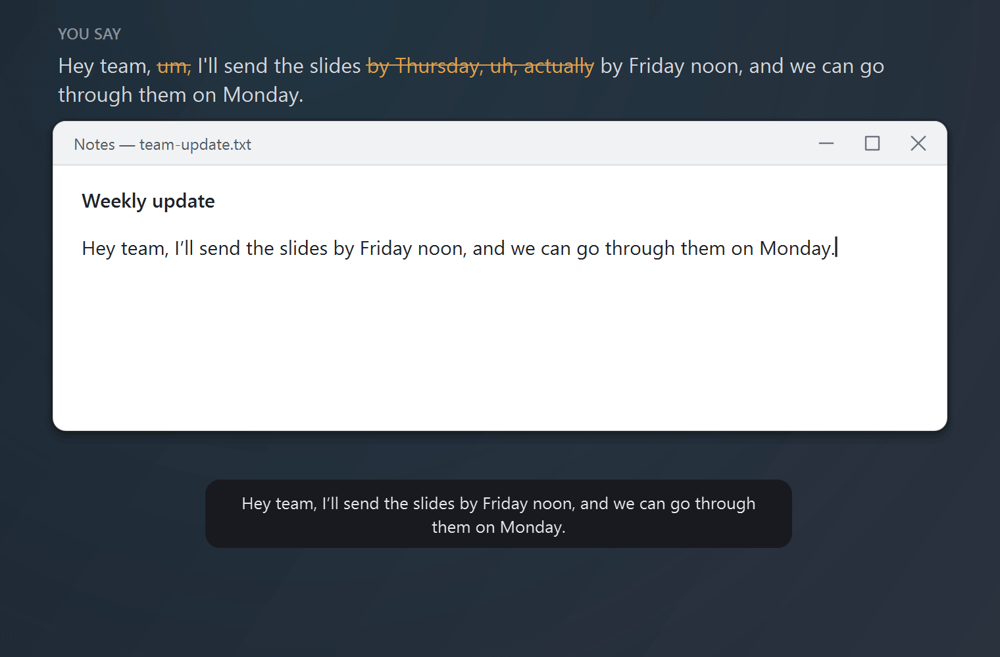
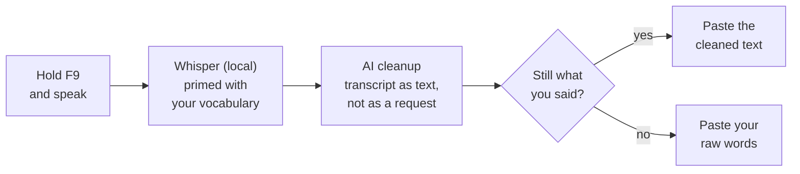
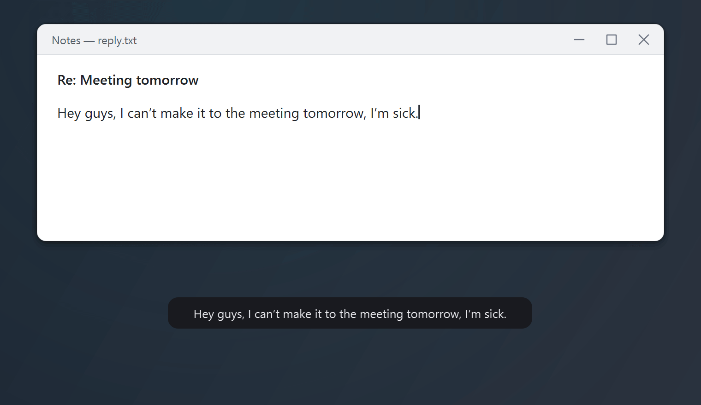
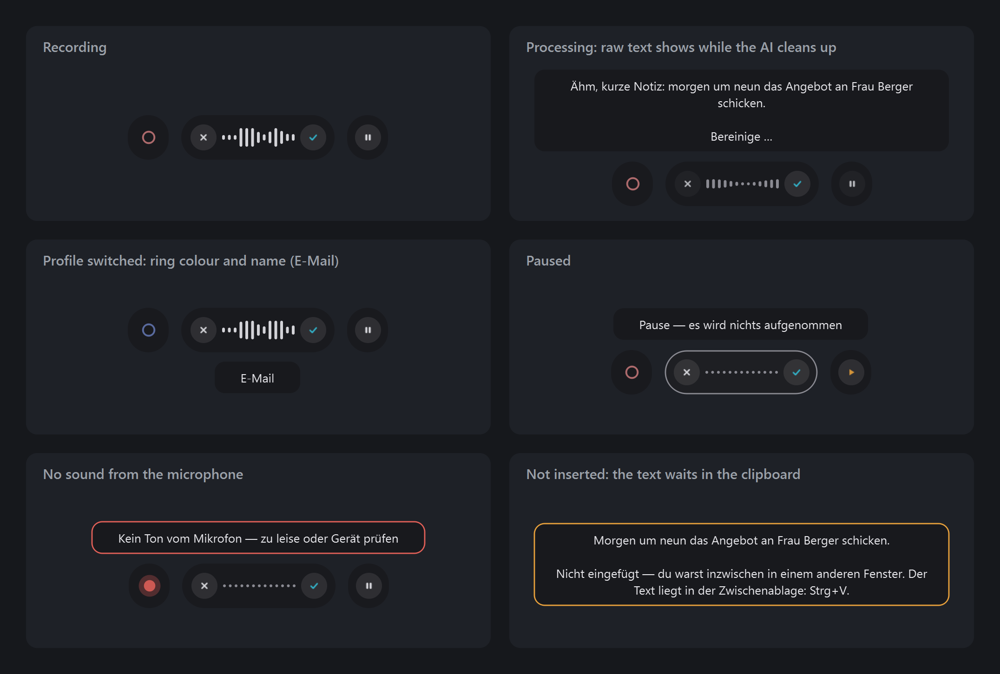

<p align="center"></p>

<h1 align="center">Fleech</h1>

<p align="center">
  <b>Local voice dictation for Windows and Linux.</b><br>
  Hold a key, speak, release: clean text appears wherever your cursor is, in your own words.
</p>

<p align="center">
  <a href="https://github.com/FynnXland/fleech/actions/workflows/tests.yml"></a>
  <a href="https://github.com/FynnXland/fleech/releases/latest"></a>
  <a href="LICENSE"></a>
  
</p>

<p align="center">
  <a href="https://github.com/FynnXland/fleech/releases/latest"><b>Download for Windows</b></a> &nbsp;·&nbsp;
  <a href="#linux-x11">Linux</a> &nbsp;·&nbsp; <a href="README.de.md">Deutsch</a> &nbsp;·&nbsp; <a href="docs/">Documentation</a>
</p>

<p align="center">
  
  <br><i>Struck through: the fillers and what you took back. Everything else stays in your words.</i>
</p>

Fleech types into the programs you already use: Word, your browser, email, chat or your
code editor. Speech recognition (Whisper) writes down what you say, a language model tidies
it up, and Fleech checks that the result still says what you said; if in doubt, you get your own
words rather than the model's. By default both models run on your computer. No account,
no subscription, and your audio never leaves your PC. Fleech is a local, open-source
alternative to cloud tools like Wispr Flow.

> [!NOTE]
> The interface is German for now; an English version is planned. Dictation works in
> **German and English** (Settings → *Allgemein* (General), or per profile).

## Why not just Whisper + ChatGPT?

You could send a Whisper transcript to a chat model with "clean this up". That works until
your dictation sounds like a request: the model cannot tell dictating from asking, so it
answers, writes code or rewords what you said. Here is the same local model (`gemma3:4b-text`) with
the same transcripts, once with a one-line prompt and once inside Fleech:

| You said | Whisper + a one-line prompt | Fleech pastes |
|---|---|---|
| Hi Sam, thanks for the documents, I'll look at them by Friday and get back to you. | Hi Sam,<br>Thanks for sending the documents. I'll **review** them by Friday and get back to you **then**. | Hi Sam, thanks for the documents, I'll look at them by Friday and get back to you. |
| What's the best way to cook rice without a rice cooker? | *"Okay, here's a cleaned-up version of how to cook rice without a rice cooker"*, then a seven-step recipe and two follow-up offers | What's the best way to cook rice without a rice cooker? |
| Write a function that sorts the list by date, uh, newest first. | The function itself, with docstring, example and usage notes: 46 lines | Write a function that sorts the list by date, newest first. |
| Can you write a short summary of the meeting notes and send it to Sam by Friday? I need it before the client call. | *"Okay, here are a few options for a cleaned-up version of your request"*: three reworded versions, then a question about the tone | Can you write a short summary of the meeting notes and send it to Sam by Friday? I need it before the client call. |

<sub>Real output at temperature 0, frozen in [docs/media/examples.json](docs/media/examples.json).
The one-line prompt was "Clean up this dictated text: remove filler words and fix
punctuation and grammar." The sentences were chosen to show typical failures.</sub>

## How it works



- **It knows your vocabulary.** Your dictionary and the terms learned per app go to Whisper
  as hints, so names come out right at the source. Phrases Whisper adds at the end with
  no sound behind them ("Thank you.") are cut before any AI sees the text.
- **Your dictation is text, not a request.** It reaches the model between markers, with
  the rule that nothing inside them is an instruction. If the reply shares less than half
  its words with what you said, you get your raw words.
- **Your words, not synonyms.** If fewer than 70% of your words survive, or too many new
  ones appear, the model gets one stricter try; below 50%, your raw words win.
- **Nothing tacked on, nothing flipped.** Closing sentences you never said are cut. A lost
  date, time or amount, or a lost "nicht" in German, gets a second try, else your raw words.

The history names the reason for every fallback. The checks compare words, not meaning: a
swapped "can" and "must" gets through. Fleech transcribes in your pauses as you speak,
so only the last part is left when you let go. Pasting uses the clipboard and
<kbd>Ctrl</kbd>+<kbd>V</kbd> (not for terminals that need <kbd>Ctrl</kbd>+<kbd>Shift</kbd>+<kbd>V</kbd>);
your clipboard comes back afterwards. Every step with its limits:
[docs/how-it-works.md](docs/how-it-works.md); for contributors: [docs/architecture.md](docs/architecture.md).

## Choose how it runs

| Mode | Speech recognition | Cleanup | What leaves your PC |
|---|---|---|---|
| **Local** (default) | Whisper `large-v3-turbo`, on your GPU or CPU | `gemma3:4b-text` via Ollama | nothing (unless you turn on the cloud fallback, see [Privacy](#privacy-and-your-data)) |
| **Your own API key** | local | OpenAI, Anthropic, Google Gemini, Mistral, Groq, OpenRouter or any OpenAI-compatible server | the dictated *text*, to the provider you chose; never audio |
| **No AI** | local | none: plain transcript, fillers removed, dictionary applied | nothing |

## Features

**Voice commands.** Say the safe word, then the instruction: "Kimono, make the last sentence
more polite" rewrites what you just dictated.

<p align="center">
  
</p>

**Profiles.** One dictation becomes clean text, an email, bullet points or a structured AI
prompt; the ring around the dot shows the active profile. Assign profiles to programs,
optionally by window title. The three rewriting formats are German only for now.

<p align="center">
  
</p>

- **Eight profiles.** Standard, *Geschäftlich* (business), *Privat* (private), Coding,
  *Mathe* (maths), *E-Mail*, *KI-Prompt* (AI prompt) and *Stichpunkte* (bullet points).
- **Personal dictionary.** Names and jargon spelled your way, and a hint for Whisper.
- **History and insights.** Search, filter and re-clean past dictations; words per minute,
  app usage and streaks.
- **German and English.** Choose the language globally or per profile.

<details>
<summary><b>More features</b></summary>

- **Formulas to LaTeX** (opt-in under Settings → *Ausgabe*, German only): spoken maths is parsed without a model, and anything ambiguous is flagged as a guess.
  <p align="center"></p>
- **Nudge mode** (*Anstupsen*): press once and talk; the dictation ends on its own when you pause.
- **Cursor return** (*Cursor-Rückkehr*): the text goes into the field where you started, even if you clicked elsewhere meanwhile.
- **Audio ducking:** music and videos get quieter while you dictate.
- **Game and fullscreen detection:** frees GPU memory by unloading the language model, and respects Do Not Disturb.
- **Keep-warm control:** keep the language model loaded for 3–45 min after a dictation, permanently, or not at all.
- **Skip the AI:** the check mark in the pill pastes the recognised text right away instead of waiting for the cleanup.
- **Spoken format suffix (German):** end with "… als Stichpunkte" or "… als E-Mail" to reformat just this dictation.
- **Spoken symbols:** "Slash", "Hashtag" and similar become the characters.
- **Dictionary suggestions:** when a word looks like a misheard dictionary term, Fleech asks "did you mean …?" and can learn it.
- **Re-clean from history:** turn an old dictation into an email, bullet points or an AI prompt (German output).
- **Markdown export** of filtered history entries; **profile export and import** as JSON.
- **Prompt editor:** view and edit the instructions behind each format, with a reset to factory.
- **Send directly:** a profile can press <kbd>Enter</kbd> after pasting, for chats.
- **German-tuned speech model:** an optional Whisper turbo retrained on German (1.6 GB).
- **Last recording:** recognise it again or save it as WAV from the tray menu.
- **No-sound warning:** the pill tells you when the microphone delivers nothing.
- **Safe settings:** atomic saves, automatic `.bak` recovery and dated backups.

</details>

## A look inside

<p align="center">
  
</p>

**The pill** sits at the edge of the screen while you dictate: profile on the left, cancel,
level and done in the middle, pause on the right. It never takes focus, so your text field
stays active, and you can drag it anywhere. It also tells you when something needs your
attention, such as a silent microphone or text that went to the clipboard.

<p align="center">
  
</p>

**One window** holds everything else: history, insights, profiles, app rules and settings.

<details>
<summary><b>More screenshots</b></summary>

**Home:** your recent dictations, searchable and filterable.
<p align="center"></p>

**Insights:** how fast and how much you dictate, in which apps and what Fleech corrected,
plus dictionary suggestions for words that keep being misheard.
<p align="center"></p>

**Profiles:** tone, format, language and safe word per profile.
<p align="center"></p>

**Settings → *Aufnahme* (Recording):** hotkeys, recording mode and microphone.
<p align="center"></p>

**Settings → *KI* (AI):** local, your own key, or no AI.
<p align="center"></p>

</details>

<sub>All screenshots and GIFs show invented sample data and real output of gemma3:4b-text.
The interface is German, so the English GIFs show German labels too.</sub>

## Installation

| Platform | Get it | Notes |
|---|---|---|
| **Windows 10/11** (64-bit) | [FleechSetup-&lt;version&gt;.exe](https://github.com/FynnXland/fleech/releases/latest) (~1 GB) | Per-user install, no admin rights |
| **Linux** (X11) | [Build from source](#linux-x11) | Tested on Kubuntu |
| **macOS** | – | Not supported |

**Requirements**

- Windows 10 or 11, 64-bit (tested on 11), or Linux with X11 (under Wayland some features
  are limited; Settings → *Advanced* lists them). A microphone; internet for the setup.
- About **10 GB** of free disk space: app 2.2 GB, Ollama 3.1 GB, language model 2.5 GB,
  speech model 1.6 GB (about 6.5 GB if Ollama is already installed). During setup another
  3.3 GB are needed briefly for the original model, which Fleech removes again.
- An NVIDIA GPU helps a lot but is not required: on the CPU, recognition is slower.

### Windows

Download `FleechSetup-<version>.exe` from [Releases](https://github.com/FynnXland/fleech/releases/latest) and run it. Fleech
installs into your user profile with a Start menu entry; autostart and a desktop shortcut are optional.

> [!TIP]
> The installer isn't code-signed yet, so SmartScreen may say "Windows protected your PC":
> choose *More info → Run anyway*. To check that the file is genuine, compare its hash with
> the `SHA256:` line in the release notes:
> `Get-FileHash .\FleechSetup-<version>.exe -Algorithm SHA256`

### Linux (X11)

```bash
git clone https://github.com/FynnXland/fleech.git && cd fleech
bash packaging/setup-linux.sh                              # venv in ~/.venvs/fleech
~/.venvs/fleech/bin/python packaging/build.py --install    # → ~/.local/opt/Fleech + menu entry
```

With an NVIDIA GPU, add `--gpu` to the last command: it bundles the CUDA libraries
(about 1 GB more). Without it, the build recognises speech on the CPU only.

### First run

A short introduction asks for your language, how the AI should run (and which model), your
microphone and your hotkey (F9 by default; any key, combination or mouse button works).
Meanwhile it downloads what you picked and shows the progress; for the local default:

| Component | Purpose | Size |
|---|---|---|
| **Ollama** | runs the language model locally | ~3.1 GB |
| **`gemma3:4b-text`** | cleans up the text: `gemma3:4b` without its image part, which Fleech never uses (about 0.8 GB less memory, same output). Fleech builds it locally from `gemma3:4b` and removes the original again if it downloaded it just for this | ~2.5 GB |
| **Whisper `large-v3-turbo`** | turns speech into text | ~1.6 GB |

Ollama is installed only when you click: on Windows via `winget`; on Linux, Fleech shows
the official install command. The introduction ends with a test dictation in its window.
Then click into any text field, hold <kbd>F9</kbd>, speak, release. The first dictation
after a start takes a few seconds longer while the models load.

## Everyday use

| Hotkey | What it does |
|---|---|
| <kbd>F9</kbd> | Dictate: hold, speak, release |
| <kbd>Ctrl</kbd>+<kbd>Alt</kbd>+<kbd>P</kbd> | During a recording: turn this dictation into a structured AI prompt (in German) |
| <kbd>Ctrl</kbd>+<kbd>Alt</kbd>+<kbd>Space</kbd> | Pause and resume the recording |
| <kbd>Ctrl</kbd>+<kbd>Alt</kbd>+<kbd>Z</kbd> | Insert the raw transcript instead of the cleaned text (once, within 120 s, same window) |
| *Profil wechseln* (switch profile) | Unbound by default: tap for the next profile, hold to pick from a list |

You can change every hotkey under Settings → *Aufnahme* (Recording) and also bind mouse
buttons 4, 5 and middle.

- **Recording modes:** *Hold-to-talk* (default), *Toggle* (press to start, press again to
  finish) or *Anstupsen* (nudge): press once, and the dictation ends after 1–4 s of silence.
- **Safe word:** "Kimono, make that more formal" acts on what you just dictated; change it
  under Settings → *Ausgabe* (Output). Off in *Geschäftlich* and the rewriting profiles.
- **Profiles:** during a recording, tap the dot on the left of the pill to cycle. The *Apps*
  page sets which profile applies where; rewriting profiles are assigned to no app at first.
- **Dictionary:** Settings → *Textersetzung* (Text replacement). Names, jargon and
  abbreviations you use a lot: the most effective tweak there is.
- **Tray:** closing the window keeps Fleech running; quit via the tray icon → *Beenden*.
- **Updates (Windows):** downloaded in the background, SHA-256 verified, installed only
  when you click.

## Privacy and your data

Fleech has no account, no telemetry and no server of its own. What leaves your PC depends
on the [mode you choose](#choose-how-it-runs). Besides that, Fleech only goes online for:

- **First-run setup:** Ollama (via `winget`), `gemma3:4b` from the Ollama library (turned
  into `gemma3:4b-text` on your machine) and the Whisper model from Hugging Face.
- **Update check:** asks GitHub for the latest release. You can turn the check off, or just
  the background download, under Settings → *Advanced*.
- **Model check:** once a week Fleech looks for a newer model for your choice, in its model
  list on GitHub and the Ollama library, or in your cloud provider's model list. It only
  suggests, never switches by itself; turn it off under Settings → *KI* (AI).
- **Optional models** from Hugging Face, only if you choose them: the German speech model
  and the small model of the experimental live preview. **Your cloud provider**, if chosen.
- **Cloud fallback** (off by default): if you pick a provider under Settings → *KI* →
  *Wenn die lokale KI hängt* (if the local AI stalls), only the dictations the local model
  doesn't finish in time or fails on are cleaned up there. The history marks them.

All data lives in one folder: `%APPDATA%\Fleech` on Windows, `~/.config/Fleech` on Linux.
History, project memory (*Gedächtnis*) and settings are **encrypted at rest** (SQLCipher with AES-256 for
the whole database files, AES-256-GCM for the settings). The key is bound to your Windows
account via DPAPI (Linux: Secret Service) and unlocks when you sign in; a recovery code
(Settings → *Allgemein* → *Verschlüsselung*) reopens your data after a Windows reinstall.
This protects against a stolen or copied disk, other accounts and backups, not against
malware in your own account while Fleech is open.

| File | What it holds |
|---|---|
| `settings.json` | Settings, profiles and dictionary (encrypted); protected by `settings.json.bak` and dated backups in `sicherungen/` |
| `history.db` | Dictation history (raw and cleaned text, encrypted); deleted after 90 days by default, can be switched off and cleared under Settings → *Allgemein* (General) |
| `kontext.db` | Project memory (encrypted): terms learned per app, used only to prime local speech recognition |
| `schluessel.dpapi` | The data key, protected by Windows (DPAPI); useless on another account or PC |
| `fleech.log` | Log (rotates at 20 MB). Contains no dictated text, only word counts, unless you turn on *Diktattexte ins Protokoll* for troubleshooting |
| `prompts/` | Prompts you edited in the prompt editor |
| `updates/` | Downloaded installers |

Audio is never written to disk, unless you save the last recording as WAV from the tray
menu. Dictations Fleech pastes are kept out of the Windows clipboard history (Win+V) and
the cloud clipboard. API keys go into the system keychain (Windows Credential Manager,
Secret Service on Linux). The uninstaller removes only the log; delete the folder to remove
everything. Security issues: see [SECURITY.md](SECURITY.md).

## Troubleshooting

| Problem | What to do |
|---|---|
| **Nothing is recognised** | Settings → *Aufnahme*: is the right microphone selected? The level in the pill must move when you speak; if the microphone delivers nothing, the pill says so. |
| **Text arrives raw, not cleaned up** | Either the model did not answer (Ollama not running, or a cloud key rejected) or a quality check kept your words on purpose. The history entry on the *Home* page names the reason. For Ollama, restart Fleech: the setup page shows what is missing. |
| **Text lands in the wrong window or only in the clipboard** | *Cursor-Rückkehr* (cursor return, under Settings → *Ausgabe*, on by default) brings the text back to the field where you started. If a result is ready more than 30 s after the recording and you are in another window by then, it goes to the clipboard and the pill tells you. |
| **Windows Defender or SmartScreen flags Fleech** | Apps packaged with PyInstaller are sometimes flagged by mistake. Compare the installer's SHA-256 with the release notes. If it matches, restore the file under *Windows Security → Protection history*, report the false positive at [microsoft.com/wdsi/filesubmission](https://www.microsoft.com/wdsi/filesubmission) and let us know in an [issue](https://github.com/FynnXland/fleech/issues). |
| **It hangs or crashes** | The log is at `%APPDATA%\Fleech\fleech.log` (Linux: `~/.config/Fleech/fleech.log`). It contains no dictated text unless you turned on *Diktattexte ins Protokoll*; remove your user name from paths before you [open an issue](https://github.com/FynnXland/fleech/issues/new/choose). |

## Development

Python 3.11 on Windows (Linux: `bash packaging/setup-linux.sh` does the same):

```powershell
git clone https://github.com/FynnXland/fleech.git; cd fleech
python -m venv .venv
.venv\Scripts\pip install -r requirements-dev.txt
.venv\Scripts\python -m fleech                  # run from source
.venv\Scripts\python -m pytest -q               # about 1,800 tests, LLM and STT mocked
.venv\Scripts\python packaging\build.py         # → dist\Fleech\Fleech.exe (--gpu for CUDA)
```

Start with [CONTRIBUTING.md](CONTRIBUTING.md) and [docs/architecture.md](docs/architecture.md). The in-depth
documents in [docs/](docs/), the [CHANGELOG](CHANGELOG.md), code comments and domain names are in German.

## Acknowledgements

Fleech builds on [faster-whisper](https://github.com/SYSTRAN/faster-whisper) and
[OpenAI Whisper](https://github.com/openai/whisper) for speech recognition,
[Ollama](https://ollama.com) and [Google Gemma](https://ai.google.dev/gemma) for the local
cleanup, [Qt for Python (PySide6)](https://doc.qt.io/qtforpython-6/) for the interface, and
primeLine's [German Whisper turbo](https://huggingface.co/primeline/whisper-large-v3-turbo-german)
for the optional German model. All bundled libraries and their licenses are listed in
[THIRD-PARTY-NOTICES.md](THIRD-PARTY-NOTICES.md).

## License

Fleech is licensed under the [MIT License](LICENSE): use, modify and redistribute it, also
in closed-source and commercial projects, as long as you keep the copyright and license
notice. Bundled libraries keep their own licenses ([THIRD-PARTY-NOTICES.md](THIRD-PARTY-NOTICES.md)).
Unless you explicitly state otherwise, any contribution you submit for inclusion in
Fleech is licensed under the MIT License as well.

Copyright © 2026 FynnXland
